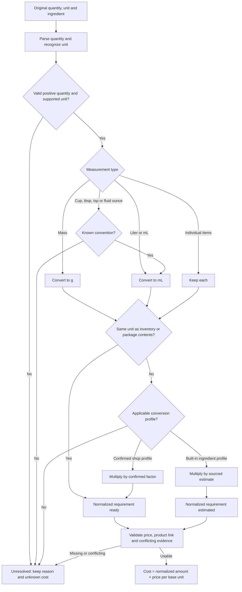

# Measurement conversion logic

The application converts recipe requirements and purchases to **grams (`g`), milliliters (`ml`) or individual items (`each`)**. It calculates cost only after the required amount and the price use the same measurement basis.

Cups, tablespoons and teaspoons follow the same path: **volume measure → mL → ingredient-specific grams**, when grams are needed. There is no single weight that applies to every ingredient.

## Conversion flow



## Quantity parsing and unit recognition

Numeric values, decimal strings, fractions such as `1/4`, mixed fractions such as `1 1/2`, and Unicode fractions such as `¼` or `1½` are supported. Empty, unrecognized and nonfinite values stay unknown. A quantity must be positive for measurement conversion; a known zero **price** is allowed.

English and Hebrew aliases are recognized, including `grams`/`גרם`, `kg`/`ק״ג`, `ml`/`מ״ל`, `tsp`/`כפית`, `tbsp`/`כף`, `cup`/`כוס` and `pieces`/`יחידות`. Product-name parsing only accepts bounded mass/volume expressions, such as `קורנפלור 500 גרם`; letters inside a product name are not treated as units.

## Conversions within a measurement type

These conversions use fixed factors and do not need an ingredient profile.

| Input | Canonical result |
| --- | --- |
| 1 g | 1 g |
| 1 kg | 1,000 g |
| 1 weight oz | 28.349523125 g |
| 1 lb | 453.59237 g |
| 1 ml | 1 ml |
| 1 L | 1,000 ml |
| 1 each | 1 each |

Weight ounces (`oz`) and fluid ounces (`fl oz`) are different: the former become grams; the latter become mL using a known convention.

## Cups, tablespoons and teaspoons

The current implementation uses the following mL per measure. Values below are displayed rounded; calculations use the full constants in [measurements.ts](../src/lib/measurements.ts).

| Convention | 1 tsp | 1 tbsp | 1 cup | 1 fluid ounce |
| --- | ---: | ---: | ---: | ---: |
| US | 4.928922 ml | 14.786765 ml | 236.588237 ml | 29.573530 ml |
| Metric | 5 ml | 15 ml | 250 ml | 30 ml |
| Imperial | 5.919388 ml | 17.758164 ml | 284.130625 ml | 28.413063 ml |

The metric fluid-ounce value is the application's explicit convention, not a universal definition. The recipe's language alone does not establish its convention. Extraction accepts a convention only with a quoted source statement; a user can confirm it in **Resolve ingredient → Spoon / cup convention**. Without a convention, these volume measures remain `ambiguous_unit`.

If inventory or package contents are already in mL, this volume conversion is sufficient. To use a gram price, the application additionally needs an ingredient-specific weight factor.

## Converting volume to grams

The formula is:

```text
normalized mL = recipe quantity × mL per measure
normalized g  = normalized mL × grams per mL for this ingredient
```

Built-in profiles are derived from the following entries recorded in the code:

| Recognized English name | Recognized Hebrew name | Weight basis |
| --- | --- | --- |
| baking powder | אבקת אפייה / אבקת אפיה | 4 g per US tsp |
| flour | קמח | 120 g per US cup |
| sugar | סוכר | 198 g per US cup |
| butter | חמאה | 113 g per half US cup |
| cocoa | קקאו | 42 g per half US cup |

These are **estimates** with [King Arthur's ingredient chart](https://www.kingarthurbaking.com/learn/ingredient-weight-chart) recorded as their source and `ka-2026-10-v1` as their version. A profile applies only to an exact recognized ingredient name after trimming and lowercasing, a US convention and no size/preparation qualifier. A longer name such as `flour, sifted` does not automatically receive the plain-flour profile. The implementation does not automatically apply these built-in profiles to metric or imperial measures or infer reverse conversions.

### Example: quarter-teaspoon of baking powder


One US tablespoon of the same baking powder uses the same profile and gives **12 g estimated**. Spoon size and ingredient weight are separate inputs; choosing a convention alone cannot establish the weight of an unsupported ingredient such as salt.

## Confirmed conversions and their scope

A user can enter a confirmed conversion factor in the recipe editor and save it for one recipe line, an ingredient in the shop, or an inventory product in the shop. For a spoon/cup recipe being costed in grams, the factor is **grams per mL**, because the volume normalization happens first.

For example, if a measured metric teaspoon of an ingredient weighs 3 g:

```text
1 metric tsp = 5 ml
confirmed factor = 3 g / 5 ml = 0.6 g/ml
2 metric tsp = 10 ml × 0.6 g/ml = 6 g
```

The factor must be finite and positive, and its source unit, target unit, optional convention and qualifier must fit the requirement. The selection order is:

1. A profile saved on this recipe line.
2. A profile for the linked inventory product in this shop.
3. A profile for the ingredient name in this shop.
4. An applicable built-in baking profile.

A selected profile that does not fit leaves the conversion unresolved; it is not silently replaced by a different estimate. Confirmed profiles record the confirming user and a version timestamp. Their scope is isolated to the shop, and saved order snapshots retain the basis used when calculated.

## Purchase quantities and price bases

Counted packages need contents; a generic `unit` price alone is insufficient. Contents may come from an explicit receipt measurement, a saved shop correction, exact-code catalog evidence or user confirmation. Conflicting contents require review.

```text
total contents = purchased count × packages per purchase × contents per package
price per base unit = actual paid amount / total canonical contents
```

Two 500 g packages paid at ₪14 become 1,000 g at ₪0.014/g. Using 50 g then costs **₪0.70**. A weighed purchase follows its measured quantity directly: 0.925 kg becomes 925 g, without multiplying package factors. The actual paid total is used when available; otherwise a known count × unit price can establish it. A disagreement above 0.011 currency units needs discount confirmation, and currency must match the shop. There is no automatic foreign-exchange conversion.

Accepted purchases with unresolved measurements stay pending and do not change stock. Compatible purchases update stock and its weighted average under transaction locks, once only:

```text
new average = (old quantity × old average + purchase paid amount)
              / (old quantity + normalized purchase quantity)
```

## Cost readiness and retained evidence

| State | Meaning |
| --- | --- |
| `ready` | The applicable measurements and price are usable without a built-in weight estimate. |
| `estimated` | An ingredient estimate or external replacement price contributes to the cost. |
| `unresolved` | A required value, profile, convention or valid price basis is missing or conflicting. |

A valid measurement conversion does not by itself prove that a product match or price is usable. Alternate measurements in the same canonical unit are checked for contradictions: differences larger than the greater of 0.01 base units or 5% make the line unresolved. Explicit recipe weights take priority over accompanying volume equivalents during extraction.

Unknown line costs remain `null`; known lines contribute to a labeled subtotal. A total recipe cost and automatic selling-price suggestion require every line to be costable and a valid yield. Repeated ingredient quantities are aggregated for stock availability. Public prices inform estimated cost and never create stock.

Persisted canonical quantities use six decimals and rates use ten. Ingredient arithmetic accumulates before output/accounting rounding. Results retain original measurement context, normalized amount, reason, convention and conversion source/version where applicable.

## Implementation references

- [measurements.ts](../src/lib/measurements.ts): parsing, unit normalization and conversion profiles.
- [purchaseNormalization.ts](../src/lib/purchaseNormalization.ts): purchase contents, paid amounts and per-unit rates.
- [recipeCosting.ts](../src/lib/recipeCosting.ts): profile selection, cost readiness and shared stock requirements.
- [verifyReceipt.ts](../src/lib/verifyReceipt.ts): evidence resolution and exactly-once stock application.
- [Feature flow](measurement-costing-feature.md) and [verification/rollout guide](measurement-costing-verification.md).
