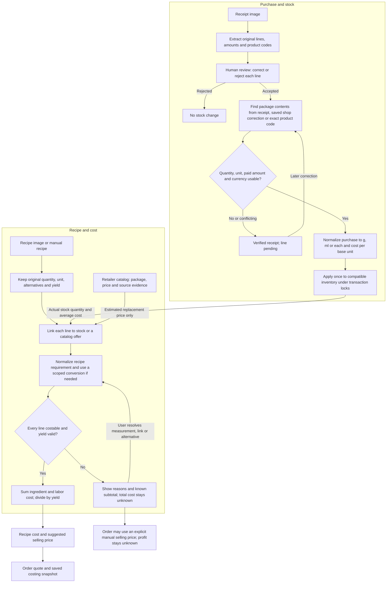

# Recipe measurement and costing

This feature calculates a recipe from the **amount of each ingredient used**, even when the recipe, receipt and product listing describe different units. For example, a recipe using 50 g from a 250 g butter package bought for ₪10 has an ingredient cost of **₪2**. The same measurement rules feed the recipe view, order quotes and order snapshots.

The core rule is simple: a product match tells us *what* an ingredient might be; a usable measurement and price basis tell us *what it costs*. A match alone cannot make an ingredient costable.

## Feature flow

## 1. Review purchases before adding stock

The receipt extractor keeps the original line text, code, quantity, unit, printed prices and purchase context for review. Codes remain strings, so leading zeros survive. An exact product lookup may provide missing package contents; retailer-specific codes need their chain context. A current catalog price is **never** substituted for the amount paid on the receipt.

For each accepted line, the system checks the count or weighed amount, package contents when needed, paid amount, and shop currency. It converts the purchase to grams, milliliters or individual items and computes a cost per base unit. Two 500 g packages paid at ₪14 become 1,000 g at ₪0.014/g. A weighed 0.925 kg purchase paid at ₪9.16 becomes 925 g with a rate based on that actual payment.

A receipt can be verified while an accepted line is still **pending** because its package size, price or measurement is unclear. Pending and rejected lines do not change stock. The owner can correct a pending line later; the database applies it once, even if verification is retried concurrently. Confirmed product contents can be saved for future purchases in that shop.

## 2. Establish a recipe requirement

Each recipe line retains its original name and measurement, including fractions, Hebrew units, printed equivalents, ingredient qualifiers and alternatives. Explicit weights take priority over an inferred volume conversion. A spoon, cup or fluid ounce needs a known US, metric or imperial convention; the application does not silently choose one. An ingredient-specific conversion, such as the sourced baking powder profile, is marked as an estimate and records its source and version. A user can save a correction for one recipe, an ingredient or a product.

The recipe line may use either:

- **Inventory:** the real remaining quantity and weighted average cost per canonical unit, once that inventory balance has a confirmed measurement basis.
- **Retailer offer:** an estimated replacement price divided by confirmed package contents. It can inform costing but never adds physical stock.

For either source, the system converts the recipe requirement to the same unit as the price basis before multiplying. Repeated lines for one inventory item remain separate in the recipe and are added together for the stock availability check.

## 3. Present complete and incomplete costs

Each line reports whether it is `ready`, `estimated` or `unresolved`, with a reason and calculation basis. A missing quantity, unsupported unit, uncertain package size, price, alternative or yield remains unresolved. An unknown line cost is `null`; a genuinely known zero price remains zero. Known lines contribute to a clearly labeled **known subtotal**.

The total production cost, per-unit cost and automatic selling-price suggestion appear only when every line is costable and the yield is valid. The catalog view, order quote and document worker all use the same costing module. An order with incomplete production cost can still be saved with an explicit manual selling price; its production cost, profit and margin remain unknown. Saved order snapshots retain the basis used at the time and completed historical amounts are not recalculated after later price changes.

## Correcting existing data

The receipt, recipe and inventory screens provide focused correction controls. Older inventory balances are marked for reconciliation because past receipts alone cannot prove how much stock was consumed. Confirming an opening balance requires the quantity, canonical unit and cost together; existing completed order amounts are preserved.

For implementation and rollout details, see [the verification and migration guide](measurement-costing-verification.md). The paired frontend behavior is recorded in [its feature verification guide](https://github.com/Neuton-AI/Neuton-Front/blob/dfd6a95873ecfd2c7075155c052a7cbff0470321/docs/measurement-costing-verification.md).
